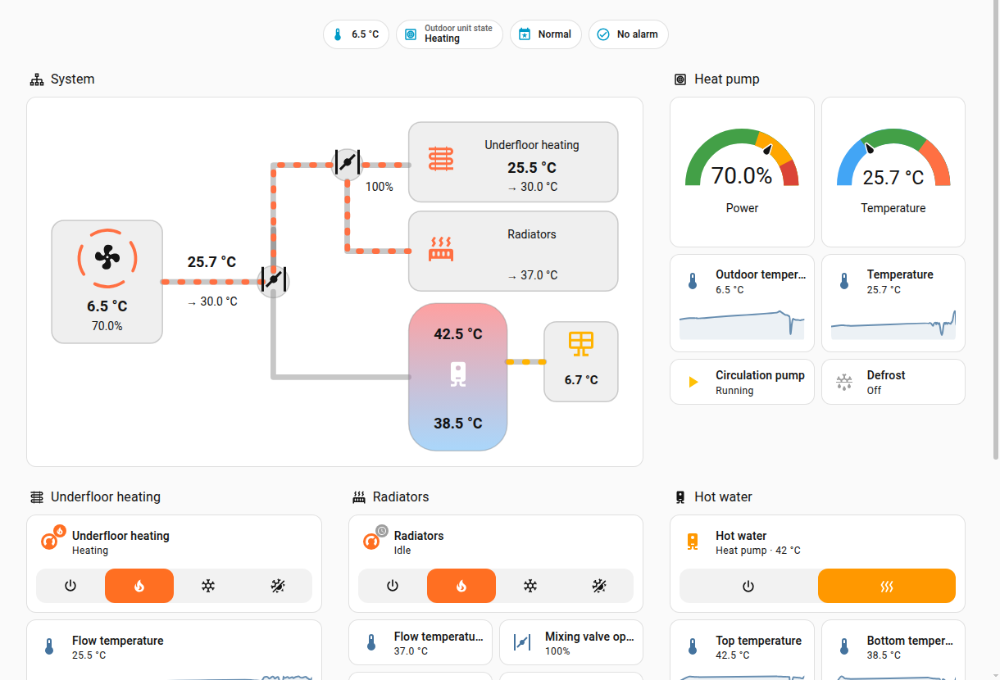

# Orca Heat Pump for Home Assistant

> **This integration is 100 % vibe coded.** Every line of its code, tests and docs was
> written by an AI, Claude Opus 5.5. No human wrote any of it.
> [How this was made](#how-this-was-made).

A Home Assistant integration for [Orca Energija](https://www.orcaenergy.eu/)
heat pumps with a networked touch display. It reads and changes the heat
pump's settings through the display's web interface on your local network;
no cloud account is needed.

> **Status: beta.** Tested live on one heat pump, a Duo 300 Solar, with recorded data
> from two more. If your setup is different, [tell us how it goes](docs/supported-setups.md#add-your-setup).

## How this was made

Claude Opus 5.5, Anthropic's AI model, wrote all of it in
[Claude Code](https://claude.com/claude-code): the code, the tests, the dashboard, the
docs and this README. Almost all of it ran on Extra High effort, the rest on High or
Max, and it used up a few full 5-hour usage limits.

- **The human:** [@rp9376](https://github.com/rp9376) wrote none of it. In their own
  words, they were "a meaty elf sitting behind a computer": watching, giving
  instructions and making the decisions, and doing whatever needed hands on the real
  pump.
- **Reviews:** done by Claude too. No human has read through the code.
- **Testing:** an automated test suite, plus live reads and writes on one real pump. See
  [what is tested](docs/supported-setups.md).
- **What it builds on:** the protocol and tag research is human work, by Tom Kern and
  the contributors of orca-energy-ha. See [CREDITS.md](CREDITS.md).

This integration can change the settings of real heating equipment, so decide for
yourself whether that is good enough for your house.

## What it does

- Shows the heat pump's temperatures, pumps, valves, defrost and outdoor unit
  state, every heating circuit, hot water, solar collectors and the buffer
  tank, as far as your pump has them.
- Lets you switch circuits and hot water on and off, choose heating or
  cooling, and change setpoints, timer programmes and the other settings the
  display offers to users.
- Reports alarms as a sensor, problem binary sensors and an event entity you
  can use to notify yourself.
- Uses one login on the display and always logs out, because the display
  allows very few logins at a time (three on the tested pump).
- English and Slovenian.

Typical uses: see and log what the heat pump does, switch heating to cooling
for summer from Home Assistant, lower the hot water temperature while you
are away, or get a notification on your phone when the heat pump raises an
alarm.

## Supported heat pumps

Orca Energija heat pumps (Duo, Mono and their variants) whose touch display
(EXOR, with the Moja Orca web interface) is connected to your network. The
integration reads the pump's wiring schema and supports all 45 of the
manufacturer's schemas: up to three heating circuits (mixing or direct),
hot water, solar collectors and a buffer tank, each with or without a room
sensor.

Tested on: a Duo 300 Solar (schema 23, firmware 61 from 2016) live, and the
recorded data of a Duo (schema 3) and a Mono (schema 7). See
[docs/supported-setups.md](docs/supported-setups.md) for what is tested and
how to help add your setup.

## Requirements

- Home Assistant 2026.11 or newer.
- The touch display's IP address on your network, and its web login
  (usually `admin`). Give the display a fixed IP address, for example a DHCP
  reservation in your router: the integration has no discovery and keeps
  using the address you enter.

## Installation

### HACS

1. In HACS, open the menu, choose **Custom repositories** and add
   `https://github.com/rp9376/orca-heatpump-ha` as an **Integration**.
2. Install **Orca Heat Pump** and restart Home Assistant.

### Manual

1. Copy `custom_components/orca_heatpump` from this repository into the
   `custom_components` folder of your Home Assistant configuration.
2. Restart Home Assistant.

## Setup

**Settings → Devices & services → Add integration → Orca Heat Pump.**

| Field | What to enter |
|---|---|
| Host | IP address (or host name) of the touch display, without `http://`. |
| Username | The display's web interface username, usually `admin`. |
| Password | The display's web interface password. |
| Allow changing power limits | Off unless you know what you're doing; see below. |

The integration logs in once to check the connection and reads which heating
circuits, hot water, solar, buffer tank and room sensors your pump has. There is
nothing to configure. If it gets your setup wrong,
[report it with your diagnostics](docs/supported-setups.md#add-your-setup).

**Allow changing power limits** makes the heat pump's power limits for
heating, hot water, cooling and quiet mode adjustable. These are service
settings: wrong values can stop the heat pump. Values outside the
manufacturer's ranges (40–100 % for heating and hot water, 16–100 % for
cooling, 31–100 % for quiet mode) are always refused: a user of the older integration
saw [their controller restart](https://github.com/Tomasinjo/orca-energy-ha/issues/20) after an automation wrote out-of-range values.
Without the option the limits are shown read-only.

## Options

**Settings → Devices & services → Orca Heat Pump → Configure.**

The only option is **Allow changing power limits**, as in the setup. Changing it swaps
the read-only power limit sensors for adjustable numbers or back, and the integration
reloads.

**Reconfigure** (in the integration's menu) changes the display's address or
login. If the display rejects the login later, Home Assistant asks you to log
in again.

## Devices and entities

Each part of the heat pump is a device: **Heat pump**, one device per heating
circuit (named after the circuit's name on the display, for example
"Underfloor heating"), **Hot water**, **Solar collectors** and **Buffer
tank**. Settings that only installers or service technicians use are hidden
(disabled by default); you can enable them in the device page.

A pump without solar that reads a temperature on its solar input, because a sensor
was wired to it for something else, also gets a **Solar input temperature** sensor. A
sensor wired later appears after the next reload.

**Heat pump**
- Sensors: outdoor temperature, temperature and its target ("HP temperature" in the
  app: the water leaving the heat pump), outdoor unit power and state, 3-way valve,
  active alarm, power limits.
- Binary sensors: circulation pump, defrost, electric heater stages, alarm.
- Selects: operating programme (normal, holiday, party, eco), quick room mode,
  electric heater mode.
- Hidden: the system on/off switch (enabled, "turn everything off" on an area or
  by voice would include it and stop heating and hot water), quiet operation, electric heater stage settings, additional heat
  source settings, PV function, screed drying, anti-blocking programme, the
  specific alarms, installer settings.

**Each heating circuit**
- Climate entity:
  - With a room sensor that regulates the circuit: a thermostat with the
    room temperature and the comfort room temperature as target.
  - Otherwise: on/off and heating or cooling only; the flow temperature is
    set with a number.
  - Modes: off, heat, cool, heat/cool (automatic switching), and auto while
    the circuit's mode on the display is "input ID2" or "manual switching".
- Sensors: flow temperature, target flow temperature and mixing valve (mixing
  circuits), room temperature (with a room sensor).
- Binary sensor: circuit pump.
- Numbers: flow temperature setpoint (constant-temperature regulation) or
  maximum flow temperature, heating curve (with outdoor-based regulation),
  reduced room temperature (with a room sensor).
- Selects: operating mode, timer programme. The timer programme's
  `schedule` attribute shows the selected programme's times and days.
- Hidden: minimum flow temperatures, cooling curve, automatic summer/winter
  switching, regulation, night setback.

**Hot water**
- Water heater: off or heat pump, with the top temperature and the higher
  setpoint as target.
- Sensors: top and bottom temperature. Number: lower temperature. Select:
  timer programme. Switch: legionella protection.
- Hidden: switch-on difference, heat pump boost, legionella temperature,
  day, hour and cycle.

**Solar collectors**: collector temperature, solar pump; hidden settings.

**Buffer tank**: temperature and target, and its heating and cooling setpoints.

## Dashboard

A ready-made dashboard ships with the integration. It uses Home Assistant's built-in
cards only, so there is nothing to install: a live diagram of the system with pipes
that animate while the heat pump produces heat or cold, gauges, trend graphs, every circuit and the alarm
history.



Use [`orca-heat-pump.yaml`](docs/dashboard/orca-heat-pump.yaml), or
[`orca-heat-pump.sl.yaml`](docs/dashboard/orca-heat-pump.sl.yaml) for Slovenian
headings:

1. **Settings → Dashboards → Add dashboard → New dashboard from scratch.**
2. Open it, then **Edit → ⋮ → Raw configuration editor**, and paste the file.
3. Circuits are named after their name on your display. Replace `underfloor_heating`
   and `radiators` with yours (see their entity IDs), and delete the parts your pump
   doesn't have.

The pipes stay still between compressor runs, even though the circulation pump usually
keeps running (its tile shows that). The grey piece at the valve shows where the valve
points; it rests on hot water when idle, which doesn't mean the water is heating.

Each circuit shows its flow temperature and its set point (`→`). On a circuit with no
flow sensor connected, the flow temperature line stays empty. The valve at the split
is the radiator circuit's mixing valve, with its opening next to it.

The mode buttons on the circuits and on hot water act at once. Anything else opens
its details when tapped, where you can change it.

## How data is updated

The integration reads all values every 30 seconds in one login, and the
weekly timer programmes once an hour (they rarely change). A change you make
is written, read back to confirm it, and the values are read again right away.
If the display doesn't answer, the entities become unavailable and come back
with the next good read. A sensor that isn't connected is unavailable; a value
the display doesn't report for the moment shows as unknown.

## Alarms

- **Heat pump Alarm** (binary sensor) is on while any alarm is active.
- **Heat pump Active alarm** (sensor) names the alarm: outdoor unit error,
  flow temperature too high in circuit 1 or 2, no flow, flow switch failure,
  heat pump temperature too low. A code the integration doesn't know yet
  shows as "Unknown alarm", with the code in the `code` attribute.
- **Heat pump Alarm** (event) fires `alarm_raised` and `alarm_cleared` with
  the alarm and its code.

The display keeps no alarm history; Home Assistant's history does. Alarms are
reset on the display, not from Home Assistant: an alarm usually means someone
should look at the heat pump itself. If you need a reset button, open a feature
request; it can be added.

Example: a notification when an alarm is raised.

```yaml
triggers:
  - trigger: state
    entity_id: event.heat_pump_alarm
    # Coming back after an outage isn't a new alarm.
    not_from:
      - unavailable
      - unknown
conditions:
  - condition: state
    entity_id: event.heat_pump_alarm
    attribute: event_type
    state: alarm_raised
actions:
  - action: notify.mobile_app_your_phone
    data:
      title: Heat pump alarm
      message: >-
        {{ state_translated('sensor.heat_pump_active_alarm') }}
        (code {{ state_attr('event.heat_pump_alarm', 'code') }})
```

Example: lower the hot water temperature when nobody has been home for a day.

```yaml
triggers:
  - trigger: state
    entity_id: person.your_name
    to: not_home
    for:
      hours: 24
actions:
  - action: water_heater.set_temperature
    target:
      entity_id: water_heater.hot_water
    data:
      temperature: 38
```

## Moving from orca-energy-ha

There is no automatic migration; the two integrations have different entity
IDs.

1. Note the entities you use in automations and dashboards.
2. Remove the Orca Energy integration (or disable its entry). Running both
   locks the display: it allows only a few logins.
3. Add Orca Heat Pump and update your automations and dashboards.

If both are set up for the same display, the setup flow warns you and a
repair issue stays open until the old one is gone.

Differences: circuit 3 is a real heating circuit; circuits without a room
sensor get a working climate entity; value ranges follow the manufacturer;
power limits are read-only unless you allow changing them.

## Troubleshooting

- **"All of the display's logins are in use" / repair issue "Heat pump
  refuses logins".** The display allows only a few logins at a time. Close
  the Moja Orca app and any other program or integration connected to the
  display, then wait a few minutes. The integration recovers on its own.
- **Cannot connect.** Check the display's IP address and that the machine
  running Home Assistant can reach it (for example with `ping`).
- **"Heat pump setup changed" repair issue.** The pump now reports different
  heating circuits, hot water, solar or buffer tank, usually after an
  installer changed the wiring schema. Confirm it to reload with the new
  setup.
- **A setting doesn't change.** The heat pump refuses values outside the
  manufacturer's range and the error says so. Numbers are rounded to what the
  pump can store (0.1 °C, whole percent for power limits). Some settings only
  take effect
  in certain modes (for example the heating curve with outdoor-based
  regulation).
- **Wrong elements detected.** Correct them in the options.
- For a bug report, download the diagnostics (device page → ⋮ → Download
  diagnostics). The address and login are removed from it.

## Automations that change settings

The controller most likely keeps its settings in memory that tolerates a
limited number of writes (not confirmed for this model). The integration
never writes a value that is already set, but an automation that changes a
setpoint every few minutes still writes often. Change settings only when
something meaningful changes, for example with a threshold of at least
0.5 °C, or at fixed times of day, and prefer the heat pump's own timer
programmes for daily schedules.

## Known limitations

- No discovery: enter the display's address and keep it fixed.
- The weekly timer programmes are shown, not edited.
- The display's own clock, passwords and installer settings are never
  changed; installer settings are shown read-only (hidden).
- Values refresh every 30 seconds, timer programmes every hour.
- The room setpoint range (10–35 °C) comes from the older integration, not the
  manufacturer's data, and no pump with a room sensor has been tested live yet.
- **Operating programme:** on the tested pump (firmware from 2016), Eco goes back to
  Normal by itself within seconds, whether the system is on or off. The Moja Orca app's
  dropdown writes the same setting. Party and Holiday weren't tried.
- The same display added under both its IP address and a host name isn't
  recognised as one display; the display has no ID of its own.

## Removal

**Settings → Devices & services → Orca Heat Pump → ⋮ → Delete.** The
integration logs out of the display. If you installed it with HACS, remove
it there too; otherwise delete `custom_components/orca_heatpump`, then
restart Home Assistant.

## Contributing

See [CONTRIBUTING.md](CONTRIBUTING.md): adding a tag, a translation or your
pump's data.

## Credits

This integration is a rewrite inspired by, and partly derived from,
[orca-energy-ha](https://github.com/Tomasinjo/orca-energy-ha) by Tom Kern
(@Tomasinjo) and its contributors. See [CREDITS.md](CREDITS.md).

Not affiliated with Orca Energija d.o.o., Carel or EXOR. "Orca" is a
trademark of Orca Energija d.o.o.

## License

[MIT](LICENSE)
